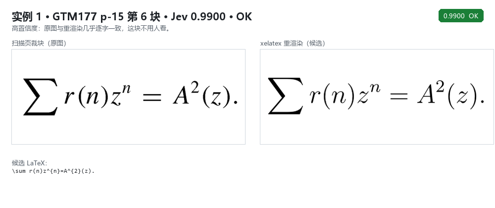
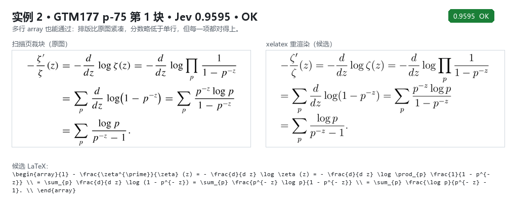
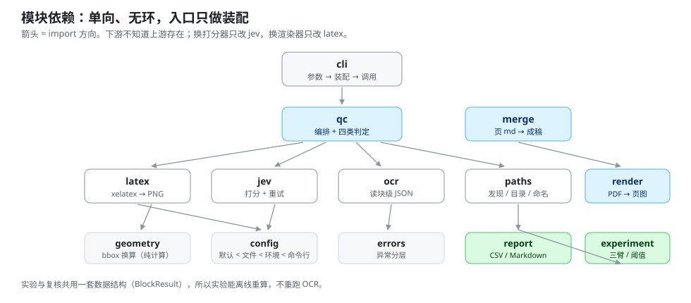

# pdf-math-formula-ocr

把**扫描版**数学书变成可信的 Markdown：正文、表格、公式都在，公式是真 LaTeX。

两段式：**整页解析**（MiniCPM-OCR）负责结构与正文，**公式复核**（Jev 打分）把公式重新渲染、逐块打分，
把可疑的和没打分到的挑出来给人看。第二段存在的理由很具体：整页解析时，长公式会被手写批注、相邻行带歪；
单独裁块、单独渲染、单独比对，才能把这类错挑出来。


> 0.3.0 起是**一个仓库跑完整条链**：`render`（PDF→页图）→ `ocr_parse.ps1`（解析）→ `qc`（复核）→ `merge`（成稿），
> 外加 `experiment`（对照组）。数字全部来自 4 本书、3,382 个公式块的实测。

## 实测规模（4 本书，3,382 个公式块）

| 书 | 公式块 | OK | CHECK | RENDER_FAIL | SCORE_ERR | 人工必看 |
|---|---|---|---|---|---|---|
| GTM001 | 1,756 | 980 | 287 | 432 | 57 | 44.2% |
| GTM002 | 193 | 135 | 52 | 6 | 0 | 30.1% |
| GTM177 | 222 | 129 | 2 | 1 | 90 | 41.9% |
| GTM178 | 1,211 | 977 | 29 | 72 | 133 | 19.3% |
| **合计** | **3,382** | **2,221 (65.7%)** | **370 (10.9%)** | **511 (15.1%)** | **280 (8.3%)** | **34.3%** |


**读法**：Jev 把人工从 100% 压到 34.3%，但其中 23.4 个百分点是「没拿到信号」（编不过 + 500），
真正靠打分判断出来的只有 10.9 个百分点，精度还未知。**编译检查的收益比 Jev 稳定**——
它不需要 GPU，四本书拦下 15.1%，而分书差异主要在 Jev 的 500 率（GTM002 0% → GTM177 40.5%）。
详细分析与「阈值 0.6 没有校准依据」见 [docs/对照组实验.md](docs/对照组实验.md)。

## 快速开始

环境（模型、Ollama 解压版、Python SDK、版面模型、TeX）见 [docs/流程.md](docs/流程.md)，一次性装好。

```powershell
# 0) 配置：复制后改成自己机器上的路径（config.json 不提交）
Copy-Item config/config.example.json config/config.json

# 1) PDF → 页图（p-01.png ...，断点续跑）
python -m pmocr render --pdf '<书目录>\GTM177.pdf' --out .\work\pages

# 2) 整页解析 → 每页一份 md + 块级 JSON
.\scripts\ocr_parse.ps1 -InputPath .\work\pages -Out .\work\out

# 3) 公式复核 → CSV + 待复核清单
python -m pmocr qc --pages <runs>\<最新>\pages_json --images .\work\pages `
                   --out .\work\qc --config config\config.json

# 4) 合并成稿
python -m pmocr merge --pages .\work\out --out .\work\GTM177.md `
                      --title '解析数论' --subtitle 'GTM177'

# 可选：量一下复核值不值（三臂对比 + 阈值扫描）
python -m pmocr.experiment --csv .\work\qc\formula_qc.csv --md 报告.md
```

`python -m pmocr.render` / `python -m pmocr.merge` 是 `render` / `merge` 子命令的等价写法。

## 四个判定


| 判定 | 含义 | 人工该做什么 |
|---|---|---|
| `OK` | 分数 ≥ 阈值 | 不用看 |
| `CHECK` | 分数低于阈值 | 带着「找错」心态看（这里抓到过真错） |
| `RENDER_FAIL` | 候选 LaTeX 编不出 PDF | 编不过说明不是可用产物，优先修 |
| `SCORE_ERR` | 打分服务失败（含重试后仍 500） | 核对而非纠错：**未打分 ≠ 错** |

## 实例（真实产物，非示意）

三张图都是 2026-11-20 在 GTM177 上跑出来的：左边扫描页裁块、右边 xelatex 重渲染，分数来自 Jev。






- **实例 1（0.9900 OK）**：两边几乎逐字一致，这块不用人看。
- **实例 2（0.9595 OK）**：多行 `array` 也能过；排版比原图紧凑，分数略低于单行，但每项都对得上。
- **第三张是反例，最值得看**：`array` 单元格默认 textstyle，求和号下限会按「上下标」排到右下角、分式变小，
  与印刷版的 display 排版不一致，Jev 因此扣分——p-19 第 3 块甚至被误报成 `0.4275 CHECK`。
  渲染模板加一行 `\everymath{\displaystyle}` 后同一块升到 `0.8304`。
  22 块样本实测：均值 0.9470 → 0.9676，5 块变好、3 块微降（≤0.0014）、1 块误报消失。

## 模块



| 模块 | 职责 |
|---|---|
| `config.py` | 默认值 < JSON < 环境变量 < 命令行；键名校验 |
| `geometry.py` | bbox 坐标系换算、等比缩放（纯计算） |
| `paths.py` | 发现输入页、准备输出目录、命名裁图 |
| `render.py` | PDF → 逐页 PNG（长边统一、断点续跑） |
| `latex.py` | 去定界符、装配 standalone 文档、xelatex → PNG |
| `jev.py` | 打分客户端：5xx 退避重试、4xx 立刻失败 |
| `ocr.py` | 解析块级 JSON，抽出公式块 |
| `qc.py` | 编排裁图 → 渲染 → 打分 → 四类判定；单块失败不中断 |
| `merge.py` | 逐页 Markdown → 一本成稿（保留下游格式） |
| `report.py` | CSV 写出/读回、Markdown 报告分节 |
| `experiment.py` | 三臂对比、标签指标、阈值扫描 |
| `cli.py` | 入口：三个子命令，只做装配与打印（无业务逻辑） |

依赖方向与设计取舍见 [docs/架构.md](docs/架构.md)。

## 配置

`config/config.example.json` 是全部可调项，也可用环境变量覆盖（`PMOCR_` + 大写字段名）：

```powershell
$env:PMOCR_JEV_URL = 'http://127.0.0.1:18499'
$env:PMOCR_THRESHOLD = '0.6'
```

源码里没有任何绝对路径、端口或模型名；换机器只改配置。`config/config.json` 已被 `.gitignore` 排除。

## 测试

```powershell
python -m unittest discover -s tests -t .
```

121 个用例，默认不联网、不占 GPU、不依赖真 TeX（真编译用例需 `PMOCR_TEST_TEX=1`）。
覆盖：配置优先级与校验、bbox 换算、定界符清洗、渲染失败/超时/0 字节 PDF、Jev 重试与不重试、
四类判定分流、报告分节、标签指标与阈值扫描、重复标签防护、PDF 渲染与成稿合并、入口退出码。

测试临时目录默认系统 temp，`PMOCR_TEST_TMP=<目录>` 可覆盖。

## 已知边界

- **手写批注**会被当成公式，识别必错，但低分能拦住。
- **跨页公式**被切成两块，两边都缺；Jev 可能因为「各自看着像」给高分，这类要留意。
- **编号**（如 `(4-x)`）会丢一部分，要编号只能人工补。
- **表格**转成 HTML table，不是 Markdown 管道表。
- **Jev 500** 是技术性失败不是识别错误，但失败率分书差异极大（0% ~ 40%），会直接影响人工成本。
- **排版保真**：多行公式被 OCR 写成 `array`，单元格默认 textstyle；渲染端必须强制 `\everymath{\displaystyle}`，
  否则求和号上下限位置、分式大小与印刷版不符，会把正确块压成低分（已修，见实例第三张）。
- **阈值 0.6 未校准**：CHECK 率在四本书里从 0.9% 到 27%，要定阈值得先有标签。
- **成稿不做自动修稿**：复核只给信号，改由人做。

## 与 GTM 全量 OCR 的关系

- GTM 那套（Windows OCR）是**保底**：快、免费、英文稳，只让正文可搜，公式仍要回到页面图。
- 这套是**成稿**：慢一点，但公式直接出 LaTeX，还有复核兜底。要精读、要笔记、要公式的书用它单独跑。

## 目录

```
pmocr/              复核包（见上表）
scripts/            ocr_parse.ps1（整页解析，参数化）
config/             config.example.json
docs/               架构 / 流程 / 对照组实验 / img（示意图）
experiments/        标签、样例 CSV、脚本生成的实验报告
tests/              单元测试
```

## License

MIT

