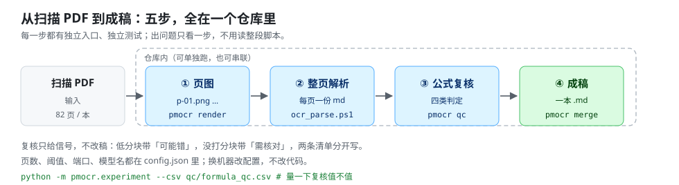
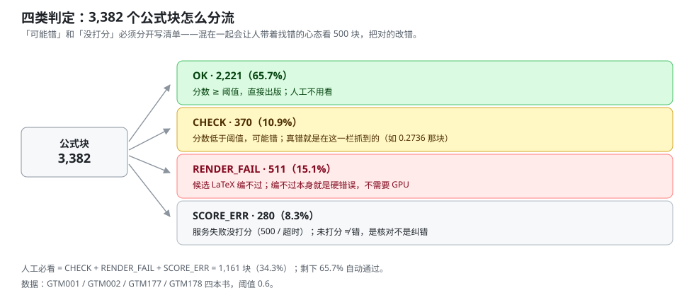
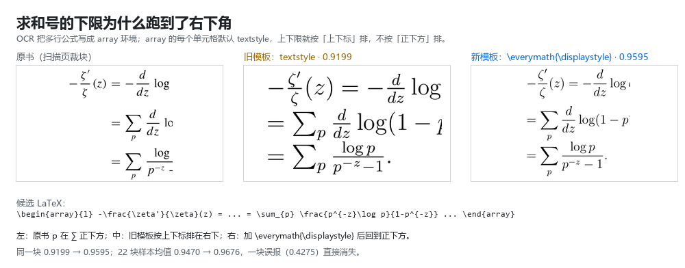

# pdf-math-formula-ocr

把**扫描版**数学书变成可信的 Markdown：正文、表格、公式都在，公式是真 LaTeX。

两段式：**整页解析**（MiniCPM-OCR）出结构与正文，**公式复核**（Jev 打分）把公式逐块重新渲染、打分，
只把可疑的挑给人看。第二段存在的理由很具体：整页解析时长公式会被手写批注、相邻行带歪；
单独裁块、单独渲染、单独比对，才能把这类错挑出来。



## 效果

**3,382 个公式块（4 本书全量，2026-11-20）**

| 判定 | 块数 | 占比 | 含义 |
|---|---|---|---|
| OK | 2,221 | 65.7% | 分数 ≥ 阈值，不用看 |
| CHECK | 370 | 10.9% | 低分，带着「找错」心态看 |
| RENDER_FAIL | 511 | 15.1% | 候选 LaTeX 编不出 PDF |
| SCORE_ERR | 280 | 8.3% | 打分服务失败，**未打分 ≠ 错** |
| **人工必看** | **1,161** | **34.3%** | 后三项之和 |

Jev 把人工从 100% 压到 34.3%，但其中 23.4 个百分点是「没拿到信号」（编不过 + 500），
真正靠打分判断出来的只有 10.9 个百分点，精度还未知（缺人工标签）。详见 [docs/03-对照实验.md](docs/03-对照实验.md)。

**吞吐（34 本 / 199 页 / 3,808 布局块，2026-11-24）**

| 项 | 数值 |
|---|---|
| 解析 | 19.4s/页（59.1 布局块/分） |
| 复核 | 2.16s/块，4 线程并行 |
| 端到端 | 89 分钟，**42.7 布局块/分**，9.7 公式块/分 |

> 口径：「块/分」默认指**布局块**（含正文）。只看公式块要乘 0.2~0.3，
> 1000 个公式块约 103 分钟，不是 24 分钟。两套数据的用途见 [docs/README.md](docs/README.md)。

**并发参数（22~24 页同一本书片段）**

| workers / np | 块/分 | 结论 |
|---|---|---|
| 32 / 1（SDK 默认） | 77.6 | 短批最快，**长书会 0xC0000005 崩溃** |
| 4 / 2 | 67.3 | 推荐：速度接近，内存只用 1/8 |
| 2 / 2 | 57.2 | 最稳，慢约 17% |

## 快速开始（复刻）

环境一次性装好：Ollama（解压版）+ MiniCPM-OCR Q8_0 / mmproj / draft + Jev 模型 + PP-DocLayoutV3 版面模型 + TeX Live，
完整命令与坑见 [docs/02-流程.md](docs/02-流程.md)。

```powershell
git clone https://github.com/wqx11235/pdf-math-formula-ocr.git
cd pdf-math-formula-ocr
python -m venv .venv; .\.venv\Scripts\Activate.ps1
pip install -e .

Copy-Item config\config.example.json config\config.json   # 改成你机器上的路径（模型、TeX、服务地址）
```

**一条命令跑完一本书**（PDF 进、成稿出）：

```powershell
python -m pmocr run --pdf '<书目录>\GTM177.pdf' --title '解析数论' --subtitle 'GTM177'
```

产物：

```
work/book.md                成稿
work/qc/formula_qc.csv      逐块判定
work/qc/报告.md             低分块清单（按分数升序）+ 未打分清单
```

分步跑（只重做某一步时用）：

```powershell
python -m pmocr render --pdf '<书目录>\GTM177.pdf' --out .\work\pages
.\scripts\ocr_parse.ps1 -InputPath .\work\pages -Out .\work\md
python -m pmocr qc    --pages <runs>\<最新>\pages_json --images .\work\pages --out .\work\qc --config config\config.json
python -m pmocr merge --pages .\work\md --out .\work\book.md --title '解析数论' --subtitle 'GTM177'
```

验证环境是否装对：

```powershell
python -m unittest discover -s tests -t .     # 145 个用例，不联网、不占 GPU
```

## 四个判定



| 判定 | 含义 | 人工该做什么 |
|---|---|---|
| `OK` | 分数 ≥ 阈值 | 不用看 |
| `CHECK` | 分数低于阈值 | 带着「找错」心态看（这里抓到过真错） |
| `RENDER_FAIL` | 候选 LaTeX 编不出 PDF | 优先修，因为它不是可用产物 |
| `SCORE_ERR` | 打分服务失败 | 核对而非纠错：**未打分 ≠ 错** |

阈值默认 0.6，**没有校准依据**；要定阈值得先有标签，见 [docs/04-数据与优化.md](docs/04-数据与优化.md)。

## 实例（真实产物）

| 图 | 说明 |
|---|---|
|  | 0.9900 OK：两边几乎逐字一致，不用人看 |
|  | 0.9595 OK：多行 `array` 也能过 |
|  | 反例：`array` 单元格默认 textstyle，求和号下限跑到右下角 |

第三张是这套系统里最值得看的一处：渲染模板加一行 `\everymath{\displaystyle}` 后，
同一块从 `0.4275 CHECK` 升到 `0.8304`，22 块样本均值 0.9470 → 0.9676，误报消失。

## 仓库结构

```
pmocr/          主包：render → ocr → qc → merge，外加 experiment 与 gate
scripts/        ocr_parse.ps1（整页解析，参数化）
config/         config.example.json（全部可调项）
docs/           01 架构 / 02 流程 / 03 对照实验 / 04 数据与优化 / 05 性能与硬件
experiments/    标签、样例 CSV、实验报告
tests/          单元测试
```

| 模块 | 职责 |
|---|---|
| `config.py` | 默认值 < JSON < 环境变量 < 命令行；键名校验 |
| `render.py` | PDF → 逐页 PNG（长边统一、断点续跑） |
| `ocr.py` / `geometry.py` / `paths.py` | 块级 JSON、bbox 换算、路径与命名 |
| `latex.py` | 去定界符、装配 standalone、xelatex → PNG（带渲染缓存） |
| `jev.py` | 打分客户端：5xx 退避重试、4xx 立刻失败 |
| `qc.py` | 裁图 → 渲染 → 打分 → 四类判定；`--qc-workers` 并发；单块失败不中断 |
| `merge.py` / `report.py` | 逐页 Markdown → 成稿；CSV 与报告分节 |
| `pipeline.py` / `cli.py` | 一键流程；入口只做装配 |
| `experiment.py` / `gate.py` | 三臂对照与阈值扫描；选择性验证（默认关闭） |

依赖方向与取舍见 [docs/01-架构.md](docs/01-架构.md)。

## 做过的优化（都有实测数字）

| 优化 | 效果 |
|---|---|
| 复核并行（`--qc-workers 4`） | 94 块 692s → **197s（3.5×）** |
| Jev 500 降分辨率重试（1600→800） | 12 个 SCORE_ERR 救回 **9 个** |
| 渲染结果缓存（按 LaTeX 哈希） | 重复实验再跑省约 11% |
| 参数 `workers=4 / np=2` | 与默认 32/1 同速，内存 1/8，不再崩长书 |

## 已知边界

- **手写批注**会被当公式，识别必错，低分能拦住。
- **跨页公式**被切成两块，两边都缺；Jev 可能给高分。
- **编号**（如 `(4-x)`）会丢一部分。
- **阈值未校准**：CHECK 率在 4 本书里 0.9%~27%。
- **成稿不做自动修稿**：复核只给信号，改由人做。

## 失败尝试（写下来，省得再踩）

| 尝试 | 结果 |
|---|---|
| 选择性验证（跳过低风险块的复核） | 739 块影子评估，**可跳 0 块**：排序首位恒为 CHECK；需要可信的置信度信号 |
| 用 token logprob 当置信度 | 60 块实测 **AUC 0.432**（低于随机），模型在错的块上同样自信 |
| 版面检测上 GPU | 版面只占 13.7%，paddle/torch 均为 CPU 构建，5060 需 CUDA 12.8；**不做** |

详见 [docs/04-数据与优化.md](docs/04-数据与优化.md)。

## 测试

```powershell
python -m unittest discover -s tests -t .
```

145 个用例，默认不联网、不占 GPU、不依赖真 TeX（真编译用例需 `PMOCR_TEST_TEX=1`）。

## License

MIT
