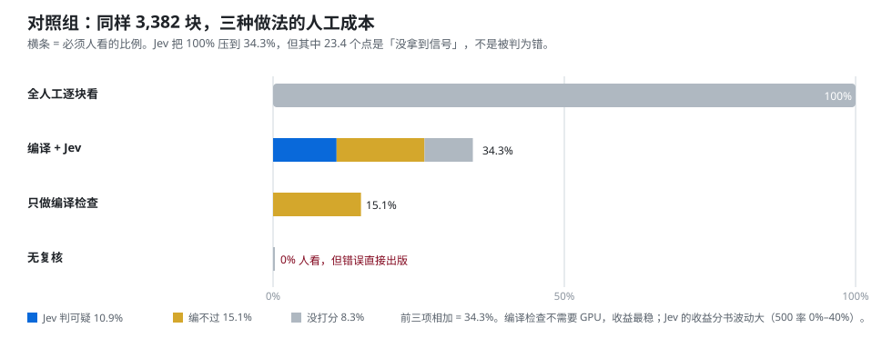

# 对照组实验：Jev 复核到底值不值

> 2026-11-20。这份文档回答一个之前只能靠感觉回答的问题：
> **加了 Jev 和没加 Jev，差别是什么？** 数字来自 4 本书、3,382 个公式块的实测 CSV，
> 以及 7 个逐字核对过的人工标签。机器生成的原报告在 `experiments/results.md`。

## 一、三臂怎么定义

同一批块，三种做法：



| 臂 | 做法 | 人工必看 | 能拦「编不过」 | 能标「可能错」 |
|---|---|---|---|---|
| **A** | 无复核：整页解析出 md 直接出版 | 0 块 | 否 | 否 |
| **B** | 只做 LaTeX 编译检查：编不过的拦下 | 511 块（15.1%） | 是 | 否 |
| **C** | 编译检查 + Jev 打分：OK 放行，其余进人工 | 1,161 块（34.3%） | 是 | 是 |

A 不是「省钱」：它把错误直接送进成稿，代价在后面（读错了要返工）。
B 是这次实验里被低估的一臂：**候选 LaTeX 编不过，说明它根本不是可用产物**，
这是比低分更硬的证据，而且不需要 GPU、不需要 Jev。

## 二、四本书的规模

| 书 | 公式块 | OK | CHECK | RENDER_FAIL | SCORE_ERR | 人工必看 | 占比 |
|---|---|---|---|---|---|---|---|
| GTM001 | 1,756 | 980 | 287 | 432 | 57 | 776 | 44.2% |
| GTM002 | 193 | 135 | 52 | 6 | 0 | 58 | 30.1% |
| GTM177 | 222 | 129 | 2 | 1 | 90 | 93 | 41.9% |
| GTM178 | 1,211 | 977 | 29 | 72 | 133 | 234 | 19.3% |
| **合计** | **3,382** | **2,221** | **370** | **511** | **280** | **1,161** | **34.3%** |

## 三、有标签子集上量出来的东西

标签来源：`人工复核报告.md` 里逐字对照过原图的 7 个块（GTM177，p-11 ~ p-14），
全部来自当时 Jev 返回 HTTP 500 的块，人工核对结论是 LaTeX 全对。

| 指标 | 值 |
|---|---|
| 标签块数 | 7 |
| 其中真错 | 0 |
| 被标成 CHECK（判为可疑） | **0** |
| 没打分（需核对） | 4 |
| 召回 | 无法估计（没有真错样本） |

**这组数字能说明的**：7 个真对块里，Jev 没有一次把它们误判成「可疑」；
但其中 4 个因为服务 500 进了「需核对」清单——那是成本，不是误判，可仍然要人看。

**这组数字不能说明的**：召回率。要估召回，标签里必须有真错样本；7 块全对，分母是 0。
之前唯一的真错案例（p-13 b5，分数 0.2736，被判 CHECK）在不同批次里，没有进这份 CSV。

## 四、阈值扫描：0.6 是不是拍出来的

| 阈值 | CHECK | 待复核 | 占比 |
|---|---|---|---|
| 0.30 | 195 | 986 | 29.2% |
| 0.40 | 246 | 1,037 | 30.7% |
| 0.50 | 300 | 1,091 | 32.3% |
| **0.60** | **369** | **1,160** | **34.3%** |
| 0.70 | 472 | 1,263 | 37.3% |
| 0.80 | 660 | 1,451 | 42.9% |
| 0.90 | 1,082 | 1,873 | 55.4% |
| 0.95 | 1,759 | 2,550 | 75.4% |

阈值只影响 CHECK 与 OK 的切分；`RENDER_FAIL` / `SCORE_ERR` 不受影响，所以即使把阈值降到 0.3，
人工也还得看 29.2%——**下限由技术失败率决定，不由阈值决定**。

0.6 目前**没有校准依据**：CHECK 率在四本书里从 0.9% 到 27%，分数分布随书漂移。
要定阈值，得有标签才能看「多拦一个真错要付多少人工」。

## 五、分书差异（这是最该先修的地方）

- `SCORE_ERR` 占比：GTM002 0% → GTM177 **40.5%**。同一套服务、同一套缩放逻辑，
  差别只在书。GTM177 的 90 个 500 把「加 Jev」这一臂的成本抬到了 41.9%。
- `RENDER_FAIL` 占比：GTM002 3.1% → GTM001 24.6%。这一臂完全不需要 Jev。

结论：**Jev 的收益不稳定，编译检查的收益很稳定**。如果只做一件事，先做编译检查。

## 六、要得出召回，需要补多少标签

不需要标注全部 3,382 块。做法：

1. 从一本书里**随机抽 150 块**（分层：OK 100、CHECK 30、未打分 20）；
2. 两块独立判读（对图看 LaTeX），冲突由第三人裁决；
3. 写进 `experiments/labels.csv`（`page,block,truth`，truth ∈ {ok, wrong}）；
4. 跑：

```
python -m pmocr.experiment --csv experiments/gtm177_formula_qc.csv \
    --labels experiments/labels.csv --md 报告.md
```

150 块里若真错约 10 块，召回的可信区间大约 ±20 个百分点；要 ±10 个百分点，
需要约 300 块、40 个真错。这比「全量人工过一遍」便宜得多，也是唯一能把阈值定下来的办法。

## 七、无法从这里推出的事

- **不能说「Jev 把准确率从 X 提到 Y」**：没有关掉 Jev 的对照跑批，也没有覆盖真错的标签。
- **不能说 0.6 是最优阈值**：只有成本曲线，没有准确率曲线。
- **不能把 34.3% 当成「复核很有用」**：其中 23.4 个百分点（15.1 + 8.3）是技术失败，
  真正由 Jev 判断带来的只有 10.9 个百分点，且精度未知。
