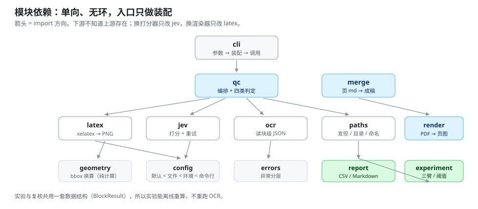

# 架构

> 2026-11-20 重构后的结构。原则只有一条：**一个模块只做一件事，入口只做装配**。



## 一、为什么拆

重构前的 `formula_qc.py` 是 164 行单文件，一个 `main()` 里同时做：
读块级 JSON、换算 bbox 坐标系、裁图、写 tex、调 xelatex、PDF 转 PNG、缩放、
拼 Jev 请求、重试、判 OK/CHECK、写 CSV、写 Markdown 报告。任何一处要改都得读完整段。

现在的分法：**能单独测的纯逻辑单独成模块，有副作用的动作各自集中，入口只留装配**。

## 二、模块表

| 模块 | 只负责 | 明确不做 |
|---|---|---|
| `config.py` | 默认值 < JSON < 环境变量 < 命令行；键名校验、类型转换 | 不读业务数据、不建目录 |
| `geometry.py` | `Size`、等比缩放、bbox 坐标系换算（纯计算） | 不开图、不写文件 |
| `paths.py` | 发现页输入、准备输出目录、命名裁图 | 不解析 JSON、不做判定 |
| `render.py` | PDF → 逐页 PNG（长边统一、断点续跑） | 不解析、不打分 |
| `latex.py` | 去外层定界符、装配 standalone 文档、xelatex → PNG | 不裁图、不认识页、不打分 |
| `jev.py` | HTTP 打分客户端、退避重试、5xx 重试 / 4xx 立刻失败 | 不渲染、不写报告 |
| `ocr.py` | 解析块级 JSON，抽出公式块（label 过滤、编号、bbox 校验） | 不碰图像、不打分 |
| `qc.py` | 编排：裁图 → 渲染 → 打分 → 四类判定；单块失败只记账 | 不写 CSV、不拼报告文本 |
| `merge.py` | 逐页 Markdown → 成稿（页码排序、跳页、空页丢弃） | 不改正文、不修公式 |
| `report.py` | CSV 写出/读回、Markdown 报告（低分与未打分分节） | 不判定、不访问网络 |
| `experiment.py` | 三臂对比、标签指标、阈值扫描 | 不产生新复核结果 |
| `cli.py` | 三个子命令解析、装配依赖、调用服务、打印摘要 | **不含业务逻辑** |
| `errors.py` | 异常分类（配置错 / 渲染错 / 服务错 / 数据错） | — |

## 三、依赖方向（单向，无环）

```
            cli ──┬──▶ render ──▶ errors
                  ├──▶ merge  ──▶ errors
                  │
                  ▼
                 qc ──────────────┐
        ┌────┬────┬───────┐       │
        ▼    ▼    ▼       ▼       ▼
   geometry latex jev   ocr     paths
        ▲    ▲    ▲       │
        │    │    │       ├─▶ latex.strip_delimiters
        │    │    │       ├─▶ geometry.Size
        │    │    │       └─▶ errors.DataError
        │    │    └──────────▶ config, errors
        │    └───────────────▶ config, errors
        └────────────────────▶ errors

   report ──▶ qc（只借用 BlockResult 与判定常量）
   experiment ──▶ report, qc, errors
   config ──▶ errors
```

规则：
- 下游模块不 import 上游（`latex` 不知道 `qc` 存在）。
- `report` 与 `experiment` 只吃结构化数据，方便离线跑。
- 换打分器 → 只改 `jev.py`；换渲染器 → 只改 `latex.py`；加判定 → 只改 `qc.py`；
  换页图来源 → 只改 `render.py`。

## 四、一次复核的数据流

```
pages_json/*.json ──ocr.load_page──▶ PageDoc(blocks)
                                        │
page PNG ──PIL──▶ page_image            │  每个 block：
                                        ▼
              geometry.scale_bbox ──▶ 裁图 ──▶ _render/<page>_b<n>_region.png
                                        │
                    latex.render(tex) ──▶ <page>_b<n>.png（xelatex → PDF → PNG）
                                        │
                       jev.score ───────▶ 0–1 概率
                                        │
                                        ▼
                         BlockResult(verdict, score, note)
                                        │
                    report.write_csv / write_markdown
```

## 五、四个判定的语义

| 判定 | 触发 | 人工该做什么 |
|---|---|---|
| `OK` | 分数 ≥ 阈值（用落盘的 4 位小数值判定） | 不用看 |
| `CHECK` | 分数 < 阈值 | 带着「找错」的心态看，这里抓到过真错 |
| `RENDER_FAIL` | 候选 LaTeX 编不出 PDF（或裁图为空） | 编不过本身说明不是可用产物，优先修 |
| `SCORE_ERR` | 打分服务失败/超时（含重试后仍 500） | 核对而非纠错：未打分 ≠ 错 |

`CHECK` 与后两类**必须分节**写报告，否则人会带着找错心态看 500 块，把对的改错（已有先例）。

## 六、测试策略

- 120 个 `unittest` 用例，默认不联网、不占 GPU、不用真 TeX：
  - 假渲染器：写出 PNG 或返回失败，覆盖成功/失败两条路径；
  - 假 Jev：线程内 `http.server`，覆盖 200 / 500 重试 / 400 不重试 / 返回体异常；
  - 假 PDF 文档对象：覆盖页命名、跳页、覆盖渲染，不需要真 PDF；
  - 入口测试用 `mock.patch` 替换 `qc.run`，只验装配与退出码，不触发真渲染；
  - 临时目录默认系统 temp，`PMOCR_TEST_TMP` 可覆盖（受限令牌下写入被拒时用）。
- 真 TeX 用例用 `PMOCR_TEST_TEX=1` 开启（`latex.render` 真编译一次）。
- 真服务冒烟：真 xelatex + 真 Jev（本机 ollama），单块得分 0.9915 → `OK`。

跑法：

```
python -m unittest discover -s tests -t .
```

## 七、刻意不做的事

- 不打包模型、不下载 GGUF：那是 `scripts/ocr_parse.ps1` 和环境文档的事。
- 不自动改 LaTeX：复核只给信号，改稿由人决定。
- 不做 GUI：报告就是 CSV + Markdown，能被任何工具消费。
- 不把多本书的结果合并后再喂标签：页名会撞车，`experiment` 检测到重复命中会直接报错。
