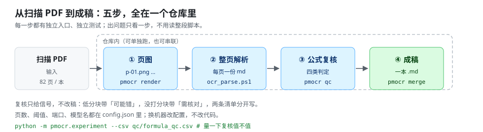

# 含公式 PDF 识别 · 完整流程

> 2026-11-20 改版。流程说明 + 环境 + 坑 + 边界；代码已拆成 `pmocr` 包，不在文档里贴全文。
> 文中的 Windows 路径是本机实测路径，换机器时改 `config/config.json`（或设 `PMOCR_*` 环境变量），
> 不要再改代码。

---

## 一、这套流程解决什么

把扫描 PDF 变成可信的 Markdown：正文、表格、公式都在，公式是真 LaTeX。

核心是两段：**整页解析**负责结构和正文，**公式复核**负责把公式挑出来单独打分。
第一段的错来自「整页上下文互相干扰」——长公式被手写批注、相邻行带歪；
第二段就是针对这个：按块裁图、单独渲染、逐块打分，低分的才给人看。

### 什么时候用这套，什么时候用 GTM 那套

| 场景 | 用哪套 |
|---|---|
| 英文数学书，只要全文可搜 | GTM 那套（Windows OCR，2.3 秒/页，免费） |
| 中文教材 / 扫描质量一般 / 要还原公式和表格 | **这套** |
| 只要某一页的公式 | GTM 的 gtm.ps1 formula 出页面图，喂视觉模型 |
| 整本书要成稿 | 这套（两段跑完 + 只看低分块） |

---

## 二、实测数据（2026-11-19，29 页扫描件）

| 项 | 数值 |
|---|---|
| 整页解析 29 页 | 约 7 分钟（CPU 版面 + GPU 识别） |
| 单页 | 约 15 秒 |
| 公式复核单块 | 约 2 秒（渲染 1.5 + 打分 0.4） |
| 显存占用 | 模型 2GB，8G 卡够用 |
| 正文准确率 | 抽查 11 页，零错误 |
| 表格 | 3 个表、26 行数字，全对 |
| 公式 | 28 个编号覆盖 23 个显式保留；抽查 40 个公式，1 处真错 |

复核验证（p-13 五个公式块）：

| 块 | 分数 | 判定 |
|---|---|---|
| 1 | 0.8626 | OK |
| 2 | 0.7031 | OK |
| 3 | 0.9590 | OK |
| 4 | 0.9766 | OK |
| 5 | **0.2736** | **CHECK** ← 唯一那块错的 |

阈值 0.6，低分的自动进待复核清单。

### 四本书全量跑完之后（2026-11-20）

同样的复核在 4 本书、3,382 个公式块上跑完，规模与人工成本见 `docs/对照组实验.md`：

| 判定 | 块数 | 占比 |
|---|---|---|
| OK 直接通过 | 2,221 | 65.7% |
| CHECK 低分 | 370 | 10.9% |
| RENDER_FAIL 编不过 | 511 | 15.1% |
| SCORE_ERR 没打分 | 280 | 8.3% |

**结论要一起看**：Jev 把人工必看从 100% 压到 34.3%，但其中 23.4% 是「没拿到信号」
（编不过 + 500），并不是被判定为错。这批数据的召回率还量不出来——缺人工标签。

---

## 三、环境（一次性，换机器照做）

全部装在 D:\deepseek_harness\.minicpm-ocr\。

| 组件 | 版本/路径 | 说明 |
|---|---|---|
| MiniCPM-OCR 模型 | ollama-models | Q8 GGUF，2GB |
| Jev 打分模型 | ollama-models | Q8 GGUF 2GB + mmproj 671MB |
| Ollama | D:\deepseek_harness\ollama-app\ollama.exe | **解压版**，不是安装版（见坑 1） |
| Python 环境 | venv312\Scripts\python.exe | Python 3.12，minicpm-ocr 1.0.5 + paddlepaddle 3.3.1 |
| 版面模型 | models\PP-DocLayoutV3_infer | 手工解压，约 130MB |
| TeX | D:\Texlive\texlive\2025 | xelatex + standalone，渲染公式用 |

### 从零装一遍（顺序别乱）

**1) 拉模型（ModelScope，国内直连）**

    $b = 'https://modelscope.cn/models'
    curl.exe -L -o MiniCPM-OCR-1_0-Q8_0.gguf  "$b/OpenBMB/MiniCPM-OCR-1.0-gguf/resolve/master/MiniCPM-OCR-1_0-Q8_0.gguf"
    curl.exe -L -o mmproj-model-f16-4x.gguf    "$b/OpenBMB/MiniCPM-OCR-1.0-gguf/resolve/master/mmproj-model-f16-4x.gguf"
    curl.exe -L -o dspark-MiniCPM-OCR-1_0-Q8_0.gguf "$b/OpenBMB/MiniCPM-OCR-1.0-DSpark-gguf/resolve/master/dspark-MiniCPM-OCR-1_0-Q8_0.gguf"
    curl.exe -L -o jev-q8.gguf      "$b/OpenBMB/MiniCPM-OCR-Jev-gguf/resolve/master/MiniCPM-OCR-Jev-Q8_0.gguf"
    curl.exe -L -o jev-mmproj.gguf  "$b/OpenBMB/MiniCPM-OCR-Jev-gguf/resolve/master/mmproj-model-f16.gguf"

**2) Ollama 用解压版**（安装器会写注册表被拒，别浪费时间）

下 ollama-windows-amd64.zip（v0.40.16 实测可用），解压到 D:\deepseek_harness\ollama-app。
然后在 gguf 所在目录，用 Modelfile 导入：

    $env:USERPROFILE  = 'D:\deepseek_harness\.minicpm-ocr\home'
    $env:OLLAMA_HOST  = '127.0.0.1:18499'
    $env:OLLAMA_MODELS = 'D:\deepseek_harness\.minicpm-ocr\ollama-models'
    D:\deepseek_harness\ollama-app\ollama.exe create minicpm-ocr -f .\Modelfile
    D:\deepseek_harness\ollama-app\ollama.exe create jev -f .\jev\Modelfile

Modelfile 内容：

    FROM ./MiniCPM-OCR-1_0-Q8_0.gguf
    FROM ./mmproj-model-f16-4x.gguf
    DRAFT ./dspark-MiniCPM-OCR-1_0-Q8_0.gguf
    PARAMETER num_ctx 8192
    PARAMETER temperature 0

Jev 的 Modelfile 只要前两行（FROM 主模型 + FROM mmproj）。

**3) Python SDK**

    & 'D:\deepseek_harness\tools\uv\uv.exe' venv --python 'D:\deepseek_harness\tools\uv-python\cpython-3.12.15-windows-x86_64-none\python.exe' venv312
    & 'D:\deepseek_harness\tools\uv\uv.exe' pip install --python venv312\Scripts\python.exe 'minicpm-ocr[all]' paddlepaddle==3.3.1 --index-url https://pypi.tuna.tsinghua.edu.cn/simple

**4) 版面模型**

    curl.exe -L -o PP-DocLayoutV3_infer.tar 'https://paddle-model-ecology.bj.bcebos.com/paddlex/official_inference_model/paddle3.0.0/PP-DocLayoutV3_infer.tar'
    tar -xf PP-DocLayoutV3_infer.tar -C models

---

## 四、日常操作

### 一键（推荐）

    python -m pmocr run --pdf 'D:\书\GTM177.pdf' --title '解析数论' --subtitle 'GTM177'

四步连着跑，产物落在 `work\`：`pages\`（默认复核后删除）、`md\`、`qc\`、`book.md`、`parse.log`。
中途失败会停在那一步、报原因，修好重跑同一条命令即可（已渲的页会跳过）。
需要保住中间某步的产物时，用下面的分步命令；`--keep-pages` 可保留页图。

### 分步（要单独改某一步时）

#### 第零步：PDF → 页图

    python -m pmocr render --pdf 'D:\书\GTM177.pdf' --out .\work\pages

产物 `p-01.png …`，长边统一（默认 8157，可 `--edge` 改）。已存在且不小于 1KB 的页会跳过，
中途断了直接重跑；要强制重渲染加 `--overwrite`。

### 第一步：整页解析

    cd <仓库根目录>
    .\scripts\ocr_parse.ps1 -InputPath .\work\pages -Out .\work\out

参数（都有默认值，可从环境变量覆盖）：

| 参数 | 作用 | 默认 |
|---|---|---|
| `-InputPath` | 页图目录（也接受 PDF） | 必填 |
| `-Out` | Markdown 输出目录 | `.\out` |
| `-MinicpmRoot` | 模型/环境根目录 | `PMOCR_MINICPM_ROOT` 或 `D:\deepseek_harness\.minicpm-ocr` |
| `-OllamaExe` | Ollama 解压版路径 | 由根目录推导 |
| `-ServerUrl` | 服务地址 | `PMOCR_JEV_URL` 或 `http://127.0.0.1:18499` |
| `-Model` | 识别模型名 | `minicpm-ocr` |
| `-SaveCrops` | 保留每块裁图 | 关 |

产物：

- out\*.md — 每页一份 Markdown（正文 + 公式 + 表格 + 图）
- <MinicpmRoot>\runs\<最新>\pages_json\*.json — 块级数据，含每块的 label / bbox / content

### 第二步：公式复核

    $py = '<MinicpmRoot>\venv312\Scripts\python.exe'
    & $py -m pmocr qc --pages <最新>\pages_json --images .\work\pages --out .\work\qc --config config\config.json

常用覆盖参数：`--threshold 0.6`、`--jev-url http://127.0.0.1:18499`、`--max-image-side 1600`、`--tex-bin-dir D:\Texlive\...`。

产物：

- 复核\formula_qc.csv — 每块一行：页、块号、bbox、分数、判定、LaTeX、备注
- 复核\待复核.md — 分两节：**低分 · 可能错**（优先看）与 **未打分 · 需核对**（不是纠错）
- 复核\_render\ — 裁图与渲染产物，排查用

### 第三步：合并成稿

    & $py -m pmocr merge --pages .\work\out --out .\work\GTM177.md --title '解析数论' --subtitle 'GTM177' --note '自动成稿：MiniCPM-OCR 解析 + Jev 复核'

按页码排序拼接，空页丢弃，`--skip 1,2` 可跳封面。产物格式与旧 `merge_book.py` 一致，下游不用改。

### 第四步（可选）：量一下复核到底值不值

    & $py -m pmocr.experiment --csv <复核目录>\formula_qc.csv --labels experiments\labels.csv --md 报告.md

给出三臂人工成本（无复核 / 只编译检查 / 编译 + Jev）与阈值扫描。标签只对单本书有效。

---

## 五、阈值怎么定

分数是「候选与区域图一致」的概率，0-1。

| 区间 | 含义 | 处置 |
|---|---|---|
| > 0.9 | 很一致 | 直接信 |
| 0.6 - 0.9 | 大致一致 | 抽查 |
| < 0.6 | 可疑 | 必须人看 |

实测分布：正确块 0.70-0.98，错误块 0.27。0.6 能干净切开。

**但 0.6 不是校准出来的值**：四本书里 CHECK 率从 0.9% 到 27% 波动，说明分数分布随书（字体、
扫描质量）漂移。要定阈值，用 `python -m pmocr.experiment --sweep` 在带标签的样本上看「人工成本 vs
检出」，而不是沿用 0.6。当前标签只有 7 块，还不够做这个决定。

---

## 六、坑（今天踩过的，按顺序）

| # | 现象 | 原因 / 解法 |
|---|---|---|
| 1 | Ollama 安装器静默失败 | 要写 AppData\Local\Programs 和注册表 HKCU\Environment，被拒。**改用 zip 解压版** |
| 2 | ollama serve 报 could not create directory ~/.ollama | 启动前把 $env:USERPROFILE 指到工作区内的 home 目录 |
| 3 | 解压版面模型 PermissionError | 运行时新建的子目录丢写权限。**先 New-Item -Force 建好目录再解压** |
| 4 | paddlex 报 C:\Users\...\.paddlex 拒绝访问 | icacls <dir> /setintegritylevel "(OI)(CI)Low" 授予低完整性写权限 |
| 5 | SDK 连不上 18499 | 服务没起。ocr_parse.ps1 会自动拉起并等就绪 |
| 6 | PowerShell 调 exe 报 \\.\pipe\... is denied | 沙箱禁命名管道捕获。用 Start-Process -RedirectStandardOutput 或 cmd /c |
| 7 | Jev 打分看着是反的 | 先确认原图到底印了什么，别拿数学常识覆盖证据（p-14 我错过一次） |
| 8 | matplotlib 渲染被 Jev 判不一致 | 字体不像。**必须用 xelatex 渲染** |
| 9 | 复核大面积 SCORE_ERR / HTTP 500 | 两个原因：bbox 是「处理后图像」坐标，要按 image_width 换算到页面图尺寸；图宽超过 1600px 也会触发，要在裁图和渲染后都做等比缩放 |

---

## 七、已知边界

- **手写批注会被当公式**：页边手写会被认成 display_formula，识别必错，但 Jev 给低分，正好被复核拦住。
- **分页公式**：跨页公式会被切成两块，两边都只认半截。
- **编号保留不完整**：28 个编号 23 个显式出现，5 个只留公式不留 (4-x)。要编号就人工补。
- **表格**：转成 HTML table，不是 Markdown 管道表。
- **页眉页码**：偶尔混进正文，后处理时要过滤。
- **Jev 偶发 500**：图太宽（>1600px）或多行 array 时，Jev 可能回 Internal Server Error。脚本已做双向缩放（裁图与渲染图都限制最长边）并加重试，仍失败才记 `SCORE_ERR`。四本书实测失败率 8.3%（280/3382），**但分书差异极大**：GTM177 是 40.5%（90/222），GTM002 是 0%。
  - **2026-11-19 复核结论**：GTM177 那 7 个 500 块已逐字对照原图，**LaTeX 全部正确，零错误**（见 `人工复核报告.md`）。所以 **500 是技术性打分失败，不是识别错误**；它和真正抓到过错的低分块（如 0.2736）是两回事。待复核清单里把 `SCORE_ERR`（未打分，需核对）和 `CHECK`（低分，可能错）分开写，别让人带着"找错"心态去看 500 块。
- **RENDER_FAIL 是信号不是故障**：候选 LaTeX 编不过，说明它本身就不是可用产物。四本书 15.1%（511/3382）落在这一类，是比低分更硬的错误证据。当前报告把它归入「未打分 · 需核对」，措辞上仍偏保守。
- **弯引号**：英文书的弯引号偶尔识别成乱码（`"change,"` 变 `??changee,??`），概率低但见到就手动改。

---

## 八、文件地图

| 路径 | 用途 |
|---|---|
| `pmocr/` | 全流程包（config / geometry / paths / render / latex / jev / ocr / qc / merge / report / experiment / cli） |
| `scripts/ocr_parse.ps1` | 整页解析（参数化，无硬编码路径） |
| `config/config.example.json` | 配置样例，复制成 `config/config.json` 后改 |
| `tests/` | 单元测试（`python -m unittest discover -s tests -t .`） |
| `docs/架构.md` | 模块边界与依赖方向 |
| `docs/对照组实验.md` | 有 Jev / 没 Jev 的量化对比与标签流程 |
| `experiments/` | 标签文件、样例 CSV、实验报告 |
| `<MinicpmRoot>\` | 模型、环境、运行目录（**别删**） |
| ↳ `ollama-app\` | Ollama 解压版 |
| ↳ `venv312\` | Python 环境 |
| ↳ `models\` | 版面模型 |
| ↳ `ollama-models\` | 两个 GGUF 模型 |
| ↳ `runs\` | 每次解析的块级数据，复核靠它 |

---

## 九、两条线的关系

GTM 那套（Windows OCR）是**保底**：快、免费、英文稳，但只让正文可搜，公式仍要回到页面图。
这套是**成稿**：慢一点，但公式直接出 LaTeX，还有自动复核兜底。

建议分工：

- 279 本全量索引 → 继续走 GTM 那套，不动。
- 要精读、要笔记、要公式的书 → 单独用这套跑一遍。

---

## 附录 · 代码去哪了

本文原先把两个脚本全文贴在附录里（单文件版）。现在代码已拆成 `pmocr` 包，
**以仓库里的源码为准**，不再在文档里复制一份，避免两边不一致：

| 想知道什么 | 看哪里 |
|---|---|
| 每个模块管什么 | `docs/架构.md` |
| 复核怎么判、报告长什么样 | `pmocr/qc.py`、`pmocr/report.py` |
| 对照组实验怎么跑 | `docs/对照组实验.md`、`pmocr/experiment.py` |
| 第一步整页解析的参数 | `scripts/ocr_parse.ps1` 顶部 param 块 |
| 配置项与默认值 | `pmocr/config.py`、`config/config.example.json` |

---

## 附录 B · 旧接口对照（迁移用）

| 旧（单文件） | 新（包） |
|---|---|
| `formula_qc.py --pages ... --images ... --out ...` | `python -m pmocr --pages ... --images ... --out ...` |
| 脚本顶部 `ROOT` / `JEV_URL` 常量 | `config/config.json` 或 `PMOCR_*` 环境变量 |
| 待复核.md 里低分与 500 混排 | 分「低分 · 可能错」与「未打分 · 需核对」两节 |
| 无 | `python -m pmocr.experiment`（对照组 / 阈值扫描） |
